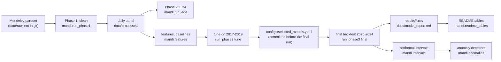
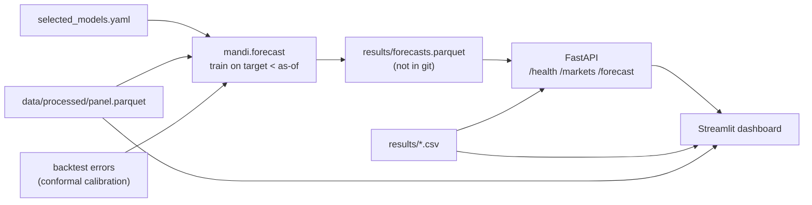
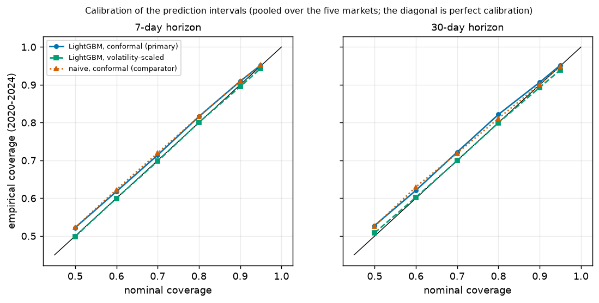
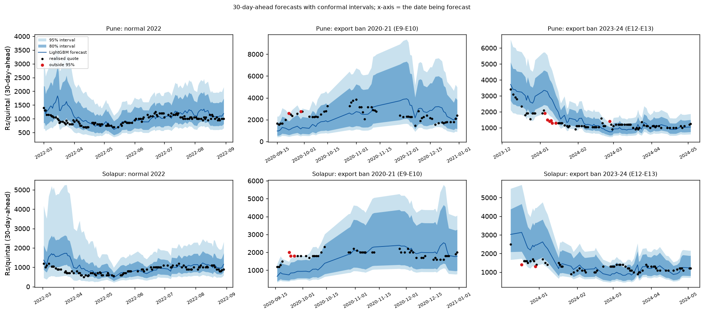
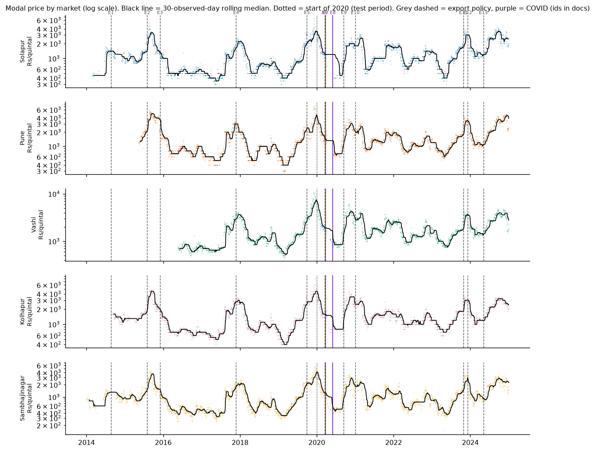
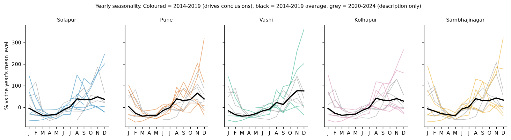

# Forecasting onion prices in five Maharashtra mandis

Daily onion prices in Indian wholesale markets (mandis) swing by a factor of three or more within a year. This project forecasts the
modal price 7 and 30 days ahead in five Maharashtra mandis, attaches calibrated prediction intervals, flags anomalous price moves, and
serves the forecasts through an API and a dashboard. The evaluation is built to be honest first: every model is compared with simple
baselines on exactly the same forecasts, with the model choice frozen and committed before the test period was ever run.

**Headline (2020-2024 out-of-sample backtest; generated from `results/`):**

<!-- BEGIN GENERATED: headline -->
- **30-day forecasts:** LightGBM improves the mean absolute error (rupees) over the strongest simple baseline by **+7.7%** (macro average of five markets; 95% block-bootstrap interval -1.8% to +14.1%).
- **7-day forecasts:** +2.7% (interval -0.1% to +5.0%): **a statistical tie with naive** (the last observed price).
- **Not uniform over time:** 2021 is a loss year at both horizons (macro -2.5%, -10.7% at 7 and 30 days).
- **Prediction intervals** are calibrated on average (80% intervals cover 81.5% at 7 days and 82.1% at 30 days) but **under-cover in shocks**: in export-ban periods the 80% interval covers 76.8% and 72.3%.
<!-- END GENERATED: headline -->

In short: a small, real-looking gain at 30 days whose uncertainty interval still includes zero, no meaningful gain at 7 days, and
intervals that are right on average but too narrow when a shock starts. Those are the numbers the data supports.

> The dataset ends 2024-12-31, so the served "latest" forecasts are as of the last data date, **not live**.

**Contents:** [Problem](#problem) · [Data](#data) · [Architecture](#architecture) · [Evaluation protocol](#evaluation-protocol) · [Results](#results) ·
[Error analysis](#error-analysis) · [Anomaly detection](#anomaly-detection) · [Limitations and next steps](#limitations-and-next-steps) ·
[Reproduce](#reproduce) · [Dashboard](#dashboard) · [Repository map](#repository-map) · [Licence and credits](#licence-and-credits)

---

## Problem

Forecast the daily **modal price** (Rs per quintal) of onions in Solapur, Pune, Vashi (New Mumbai), Kolhapur and Chattrapati Sambhajinagar,
**7 and 30 calendar days ahead**, with 80% and 95% prediction intervals.

Why it is hard:

- **Prices are close to a random walk.** In 2014-2019 the weekly log price has an AR(1) coefficient near 1 and its changes are nearly
  unpredictable (`docs/eda_findings.md`). "Tomorrow equals today" is a very strong baseline, so the honest question is whether anything beats it.
- **Shocks dominate.** Export bans, minimum export prices, floods and the COVID lockdown move prices far more than any regular pattern.
- **The yearly pattern is irregular.** Prices are usually low in Feb-May and high in Nov-Jan, but the size and timing change every year.
- **Missing days are structural.** Each market closes on a fixed weekday and on public holidays, and reporting has gaps of weeks.

## Data

- **Source:** *Preprocessed onion 2014-2024 prices, weather and events* (Shelar, Hajare, Mangarule), Mendeley Data,
  **DOI [10.17632/ds9jmxp9zy.1](https://doi.org/10.17632/ds9jmxp9zy.1)**, licence **CC BY 4.0**. Prices and arrivals originate from
  **Agmarknet** (Directorate of Marketing and Inspection, Government of India); the file's weather columns come from **IMD** gridded data.
  Full credits: [DATA.md](DATA.md). The data is **not** in this repository; download it yourself (see [Reproduce](#reproduce)).
- **Used:** daily modal, min and max prices and arrivals; calendar and festival flags. The file's own lag, rolling and climate columns are
  ignored (several use future information; `docs/eda_findings.md`). No weather feature is used in version 1.
- **Limits:**
  - the data **ends 2024-12-31**;
  - **Lasalgaon, the main price-setting onion market, is absent** (as are Niphad, Pimpalgaon, Saykheda, Yeola and Chandwad), so these
    are five Maharashtra mandis, not the benchmark market;
  - **Vashi has a shorter history** (from May 2016);
  - quotes are reported modal prices with a **reporting lag**, and many days have no quote;
  - **one variety per market** (its most frequent), never mixed with other varieties.
- Cleaning decisions (one variety per market, six reviewed outlier quotes set to missing, nothing imputed in the target) are logged in
  `docs/cleaning_log.md`.

## Architecture





Docker: one image, two services (`api`, `dashboard`), with `./results` and `./data/processed` mounted read-only (`Dockerfile`,
`docker-compose.yml`, `docs/serving.md`).

## Evaluation protocol

What makes the numbers trustworthy:

1. **Rolling origin, expanding window.** A forecast origin is a day with an observed quote; the target is the quote 7 or 30 days later,
   scored only if it exists. Models are refit on the first day of every month using only data before that day.
2. **Embargo on labels.** A training row is used only if its *target* date is before the refit date (tested: `tests/test_embargo.py`).
   Features use only data up to the origin (tested by changing all later data: `tests/test_features.py`).
3. **Tuning only on 2017-2019.** 25 candidate configurations were scored on 2017-2019 folds; the test years were never looked at.
4. **Selection committed before the final run.** `configs/selected_models.yaml` was committed in its own commit; the final run refuses to
   start unless that file is committed and the code is clean.
5. **One final run**, logged in `results/run_log.csv` with the code commit, a dirty flag (False) and the commit of the selection file.
6. **Fairness filter.** Every model and baseline is scored on exactly the same (market, origin, horizon) triples.
7. **Hard baselines.** The benchmark is the *strongest* of naive (last price), the mean of the last 3 quotes and a 365-day seasonal-naive,
   chosen per market and horizon on the test window itself (a conservative, hindsight choice). The headline model (LightGBM at both
   horizons) was fixed by the pooled tuning score before the test period.
8. **Uncertainty and multiple testing.** Block bootstrap over origin days (same days for all markets), Diebold-Mariano tests with the
   Harvey correction, and a Holm adjustment over the ten market-horizon tests.
9. **Everything reported.** All model families on every market and horizon, sensitivity runs side by side, post-hoc analyses labelled
   as such. Details: `docs/model_report.md`, `docs/tuning_report.md`.

## Results

<!-- BEGIN GENERATED: macro -->
Improvement in rupee MAE over the strongest baseline (positive = better), equal-weight average of the five markets:

| horizon (days) | headline LightGBM vs strongest baseline | LightGBM vs naive | ETS (= ARIMA(0,1,1)) vs strongest | SARIMA(0,1,1) vs strongest | Prophet (off the shelf) vs strongest | Prophet anchored vs strongest |
|---|---|---|---|---|---|---|
| 7 | +2.7% | +3.0% | -0.3% | -0.3% | -167.6% | -1.8% |
| 30 | +7.7% | +7.9% | -0.2% | -0.2% | -36.8% | +3.0% |
<!-- END GENERATED: macro -->

<!-- BEGIN GENERATED: bootstrap -->
Block bootstrap of origin days (30-day blocks, the same days for all markets, 2000 resamples, seed 42):

| horizon (days) | improvement vs strongest | 95% interval | share of resamples above 0 | improvement vs naive | 95% interval (vs naive) |
|---|---|---|---|---|---|
| 7 | +2.7% | -0.1% to +5.0% | 97% | +3.0% | +0.5% to +5.2% |
| 30 | +7.7% | -1.8% to +14.1% | 95% | +7.9% | -1.5% to +14.1% |
<!-- END GENERATED: bootstrap -->

<!-- BEGIN GENERATED: per_market -->
Per market (Diebold-Mariano test against the strongest baseline, Harvey correction; Holm adjustment over the ten tests):

| market | h | strongest baseline | baseline MAE (Rs) | LightGBM MAE (Rs) | vs strongest | vs naive | DM p | Holm p | forecasts |
|---|---|---|---|---|---|---|---|---|---|
| Kolhapur | 7 | naive | 189 | 185 | +2.0% | +2.0% | 0.367 | 1.000 | 1149 |
| Pune | 7 | naive | 221 | 216 | +2.4% | +2.4% | 0.168 | 1.000 | 1211 |
| Sambhajinagar | 7 | mean3 | 246 | 226 | +8.1% | +9.6% | 0.000 | 0.001 | 1185 |
| Solapur | 7 | naive | 214 | 209 | +2.5% | +2.5% | 0.258 | 1.000 | 956 |
| Vashi | 7 | naive | 256 | 260 | -1.6% | -1.6% | 0.512 | 1.000 | 1113 |
| Kolhapur | 30 | naive | 397 | 367 | +7.6% | +7.6% | 0.202 | 1.000 | 933 |
| Pune | 30 | naive | 467 | 419 | +10.4% | +10.4% | 0.040 | 0.360 | 983 |
| Sambhajinagar | 30 | mean3 | 414 | 383 | +7.5% | +8.2% | 0.092 | 0.645 | 956 |
| Solapur | 30 | naive | 429 | 404 | +6.0% | +6.0% | 0.358 | 1.000 | 773 |
| Vashi | 30 | naive | 593 | 550 | +7.3% | +7.3% | 0.079 | 0.630 | 907 |
<!-- END GENERATED: per_market -->

Reading the tables: ETS and SARIMA(0,1,1) are the same model and tie with naive, as a near-random walk predicts. Off-the-shelf Prophet ignores
the latest prices and is far worse; anchoring it to the last price helps but does not reliably beat naive. LightGBM is the only family
with a consistent edge, larger at 30 days. At 7 days its gain comes from a minority of large moves: it beats the baseline on about half of
the forecasts and its median error is not better (`docs/model_report.md`, section 5.4).

**Prediction intervals** (`docs/interval_report.md`):

<!-- BEGIN GENERATED: coverage -->
Rolling split-conformal intervals, 2020-2024 (macro over markets; block-bootstrap interval of the coverage):

| method | h | nominal | coverage | 95% interval | mean width (Rs) | width / forecast |
|---|---|---|---|---|---|---|
| LightGBM conformal | 7 | 80% | 81.5% | 78.2% to 85.1% | 716 | 45% |
| naive conformal (comparator) | 7 | 80% | 81.6% | 78.4% to 85.1% | 768 | 48% |
| LightGBM conformal | 7 | 95% | 95.2% | 93.4% to 96.7% | 1300 | 80% |
| naive conformal (comparator) | 7 | 95% | 95.2% | 93.6% to 96.8% | 1383 | 86% |
| LightGBM conformal | 30 | 80% | 82.1% | 77.3% to 86.9% | 1497 | 92% |
| naive conformal (comparator) | 30 | 80% | 81.1% | 75.5% to 86.7% | 1696 | 104% |
| LightGBM conformal | 30 | 95% | 95.1% | 92.7% to 97.2% | 2420 | 152% |
| naive conformal (comparator) | 30 | 95% | 94.9% | 92.3% to 97.5% | 2785 | 174% |
<!-- END GENERATED: coverage -->





## Error analysis

**By year.** One year goes clearly against the model at both horizons; the loss is concentrated in a few months and is not explained by
larger price moves or a persistent bias in that year (`docs/model_report.md`, section 5.3).

<!-- BEGIN GENERATED: per_year -->
LightGBM vs the strongest baseline by target year (macro over markets):

| target year | 7 days | 30 days |
|---|---|---|
| 2020 | +6.4% | +16.1% |
| 2021 | -2.5% | -10.7% |
| 2022 | +2.4% | +11.6% |
| 2023 | +5.2% | +18.0% |
| 2024 | +1.2% | +4.5% |
<!-- END GENERATED: per_year -->

**Shocks.** Gains are larger in the export-ban and minimum-export-price periods than in normal periods, but the intervals under-cover
exactly there, because the conformal calibration window widens only after the large errors have resolved. These periods also hold the
largest price moves and there are few of them, so this is descriptive, not causal.

<!-- BEGIN GENERATED: events -->
By event period (high-confidence event dates; see docs/eda_findings.md):

| period of the target date | h | forecasts | log-MAE improvement vs strongest | 80% interval coverage |
|---|---|---|---|---|
| covid | 7 | 42 | -2.8% | 66.7% |
| export_ban | 7 | 1030 | +4.9% | 76.8% |
| mep | 7 | 123 | +7.7% | 71.5% |
| normal | 7 | 4419 | +2.4% | 83.1% |
| covid | 30 | 38 | +7.0% | 89.5% |
| export_ban | 30 | 792 | +14.9% | 72.3% |
| mep | 30 | 106 | +19.1% | 53.8% |
| normal | 30 | 3616 | +8.0% | 85.1% |
<!-- END GENERATED: events -->

**Long gaps.** After a gap of a week or more before the origin the model does worse than the baseline (few cases):

<!-- BEGIN GENERATED: gaps -->
| days since the previous quote | h | forecasts | log-MAE improvement vs strongest |
|---|---|---|---|
| 1 day (consecutive) | 7 | 4183 | +3.0% |
| 2 days | 7 | 1147 | +4.3% |
| 3-6 days | 7 | 259 | +1.8% |
| 7+ days | 7 | 25 | -29.9% |
| 1 day (consecutive) | 30 | 3260 | +9.9% |
| 2 days | 30 | 1028 | +11.2% |
| 3-6 days | 30 | 243 | +9.2% |
| 7+ days | 30 | 21 | -13.8% |
<!-- END GENERATED: gaps -->

**Where the gain comes from.** Most of the 30-day gain disappears without the calendar features (month, week of year, weekday, expected
closure); the other-market features add a little; the mean-reversion and gap features add nothing measurable.

<!-- BEGIN GENERATED: ablation -->
**Post-hoc, not used for any choice.** Refitting the frozen LightGBM without one feature group (macro over markets):

| h | feature group dropped | change in MAE | remaining improvement vs strongest |
|---|---|---|---|
| 7 | calendar | +1.7% | +1.0% |
| 7 | days since last quote | +0.0% | +2.7% |
| 7 | mean reversion | -0.2% | +2.9% |
| 7 | other market | +0.7% | +2.1% |
| 7 | (none: full model) | +0.0% | +2.7% |
| 30 | calendar | +6.6% | +1.7% |
| 30 | days since last quote | +0.2% | +7.6% |
| 30 | mean reversion | +0.2% | +7.6% |
| 30 | other market | +1.0% | +6.8% |
| 30 | (none: full model) | +0.0% | +7.7% |
<!-- END GENERATED: ablation -->





## Anomaly detection

Three detectors, each validated by injecting synthetic spikes (±25%, 40%, 60%; 1 and 3 days) into an in-memory copy of the cleaned series.
Only the forecast-surprise detector combines a false-positive rate at its nominal level with useful recall, and only for large spikes at
7 days; the other two flag a large share of ordinary dates. Flagged up-spikes do not coincide with arrival drops more often than ordinary
days do. No causes are claimed (`docs/anomaly_report.md`).

<!-- BEGIN GENERATED: anomalies -->
Recall and false-positive rate from injecting synthetic spikes into an in-memory copy of the series (a test of the detectors, not data):

| detector | what it is | flags | false positives (ordinary dates) | recall, 25% spike | recall, 40% spike | recall, 60% spike |
|---|---|---|---|---|---|---|
| forecast_surprise_h7 | real time: outside the 95% interval issued 7 days earlier | 269 | 4.8% | 23% | 56% | 84% |
| forecast_surprise_h30 | real time: outside the 95% interval issued 30 days earlier | 219 | 4.9% | 10% | 27% | 54% |
| stl_residual | retrospective large-swing detector (not a spike detector) | 460 | 18.7% | 5% | 8% | 16% |
| causal_daily | real time: distance from a 28-quote median (noisy comparator) | 1930 | 19.6% | 34% | 56% | 74% |
<!-- END GENERATED: anomalies -->


## Limitations and next steps

**Limitations**

- Lasalgaon is not in the data; results may not carry over to the price-setting market.
- One test path (2020-2024) with large year-to-year differences; the 30-day interval for the gain still includes zero.
- The five markets move together, so they are not five independent tests; horizons overlap, so the Diebold-Mariano test is approximate.
- The strongest baseline is chosen on the test window (conservative, but a hindsight choice).
- Intervals under-cover in shocks and are wide at 30 days.
- Prophet is disadvantaged by the monthly refit design (it does not update between refits).
- Some event dates are medium or low confidence (`docs/eda_findings.md`); only high-confidence ones are used in the analysis.
- No weather features in version 1.
- The EDA notebook (`notebooks/02_eda.ipynb`) is committed **unexecuted** (it embeds the saved figures); executing notebooks was blocked
  on the development machine by Windows Application Control, and this was not worked around.

**What I would do next**

1. **Adaptive conformal inference** to repair the interval under-coverage at the start of shocks.
2. **Weather features** (lagged rain and temperature) as a declared ablation.
3. **Lasalgaon data** from another Agmarknet extract, to test on the benchmark market.
4. **A true holdout** once 2025 data exists: the serving forecasts for January 2025 can then be scored without any re-tuning.
5. A daily anomaly detector with a threshold calibrated to a target false-positive rate.

## Reproduce

Requirements: Python 3.12 (the project was developed on Windows 11 with Python 3.12.10; Python 3.14 is not used). The data must be
downloaded by hand from the DOI above to `data/raw/preprocessed_onion_2014_2024_prices_weather_events.parquet`.

```bash
python -m venv .venv && source .venv/bin/activate        # Windows: python -m venv %USERPROFILE%\.venvs\fada  then  ...\Scripts\activate
python -m pip install -r requirements.txt

# the package lives in src/ and is not pip-installed: put it on the path
export PYTHONPATH="src:."                                 # Windows (PowerShell): $env:PYTHONPATH = "src;."   (cmd: set PYTHONPATH=src;.)

python -m mandi.run_phase1                 # clean -> data/processed/panel.parquet, docs/cleaning_log.md
python -m mandi.run_eda                    # EDA figures and docs/eda_numbers.md
python -m mandi.run_phase3 tune            # FIRST: tuning on 2017-2019 -> configs/selected_models.yaml and the saved tuning-run forecasts
git add configs/selected_models.yaml && git commit -m "freeze selection"   # the final run refuses to start otherwise
python -m mandi.run_phase3 final           # the one final 2020-2024 backtest -> results/
python -m mandi.run_phase3 final --variant error      # sensitivity (a)
python -m mandi.run_phase3 ablation        # post-hoc ablation
python -m mandi.posthoc                    # bootstrap, Holm, 2021 breakdown, gain concentration
python -m mandi.report_tuning && python -m mandi.report_model
python -m mandi.intervals                  # conformal intervals (seeded with the tuning run's saved forecasts)
python -m mandi.anomalies                  # detectors and synthetic validation
python -m mandi.report4                    # docs/interval_report.md, docs/anomaly_report.md
python -m mandi.forecast                   # serving forecasts -> results/forecasts.parquet
python -m mandi.readme_tables              # regenerate the result blocks of this README
python -m pytest -rs                       # tests; those needing local data skip and say which files are missing
```

**The tuning run must come first:** the interval calibration and the anomaly validation are seeded with the saved forecasts of the tuning
run (`results/runs/tune_*`, not in git). A new tuning run gets a new run id, so the selection file and everything downstream must be regenerated.

Serving:

```bash
python -m uvicorn api.main:app --port 8000            # plain uvicorn; needs PYTHONPATH as above
python -m streamlit run app/dashboard.py               # set MANDI_API_URL if the API is elsewhere
docker compose up --build                              # alternative; see docs/serving.md
```

CI (`.github/workflows/ci.yml`) runs the tests without the data (tests that need it skip and are listed), checks that this README's
result blocks match `results/*.csv`, and builds the Docker image and checks the API container's health with a synthetic fixture file.

## Dashboard

*Screenshots to be added.*

<!-- Add dashboard screenshots here: Forecast tab, Backtest tab, Anomalies tab. -->

## Repository map

| Path | What it holds |
|---|---|
| `src/mandi/` | pipeline: cleaning, EDA, features, models, backtest, evaluation, intervals, anomalies, serving forecasts, report generators |
| `api/main.py`, `app/dashboard.py` | FastAPI service and Streamlit dashboard |
| `configs/config.yaml` | every path, market, horizon, seed and model setting; `configs/selected_models.yaml` is the frozen selection |
| `results/` | committed aggregate tables and figures (row-level outputs are git-ignored) |
| `docs/` | cleaning log, EDA findings, tuning, model, interval and anomaly reports, serving notes |
| `tests/` | unit, leakage, embargo, regression, API and dashboard tests |
| `project.md` | the project brief and every decision taken along the way |

## Licence and credits

Code: MIT ([LICENSE](LICENSE)). Data: CC BY 4.0, by Shelar, Hajare and Mangarule (Mendeley Data, DOI 10.17632/ds9jmxp9zy.1), from Agmarknet
(Directorate of Marketing and Inspection) and IMD; see [DATA.md](DATA.md). The data and all row-level derived data are kept out of this
repository.
