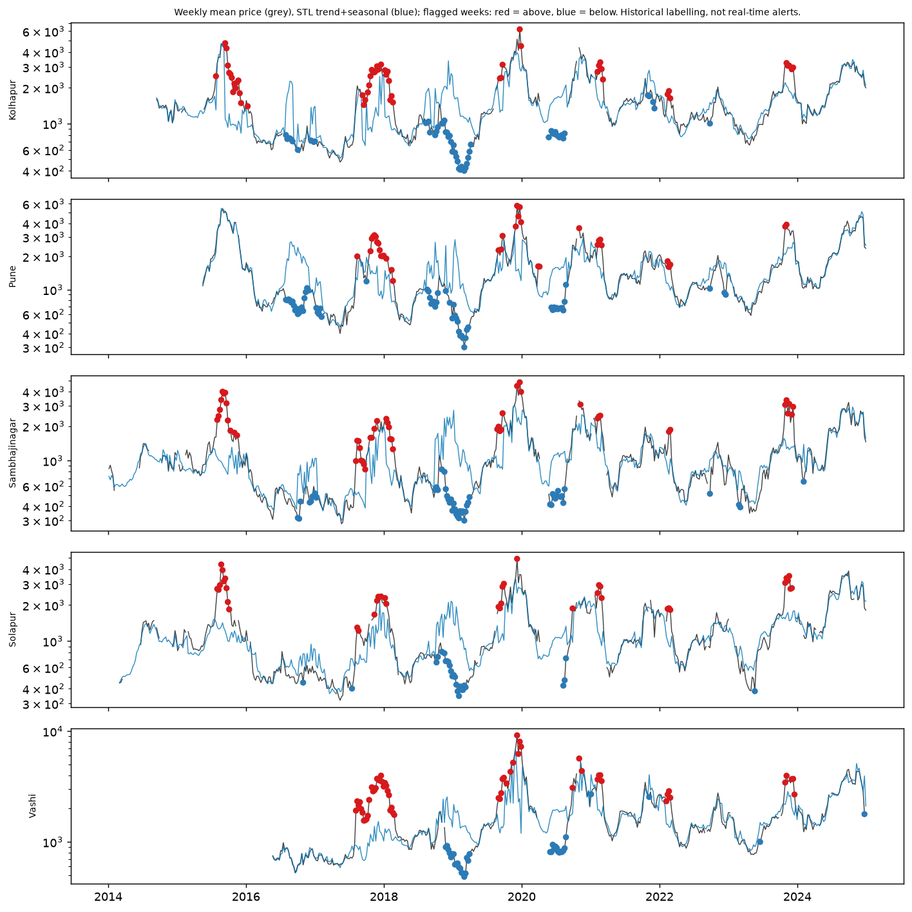

# Anomaly detection (Phase 4B)

## Detectors (declared before any result was looked at)

- **Detector 1, `stl_residual` (retrospective).** STL with robust=True and period 52 on the weekly mean of log modal price (observed days only; a week needs at least 3 observed days). A week is flagged when |residual - median| > 3.5 x 1.4826 x MAD. **It uses data after the date as well, so it is historical labelling, not a real-time alert.** Unobserved weeks are bridged by linear interpolation only so that STL can run; they are never flagged and are not used for the median or MAD. The date reported is the Sunday that ends the week.
- **Detector 2, `forecast_surprise_h7` and `_h30` (usable in real time).** The realised quote falls outside the 95% conformal interval of the headline LightGBM issued h days earlier (section 1 of `docs/interval_report.md`). Available for 2020-2024 only. `score` = (log realised - log forecast) / interval half-width, so |score| > 1 means outside.
- **Arrivals check.** `arrivals_z` = z-score of the mean log arrivals of the flagged week (or day) against the median and MAD of the log arrivals of the 30 days before it. A "drop" means z <= -1.0.
- **Event-period labels** use only periods whose both end dates are high-confidence in `docs/eda_findings.md` (the 2019-20, 2020-21 and 2023-24 export bans and the COVID lockdown); `none` means outside those periods (the unverified Oct-Dec 2023 MEP period is not used).
- No causal claims are made anywhere: the table says when, where, how large, and what arrivals did.
- The full table is `results/anomalies.csv` (not committed: it lists individual market-dates); this document shows aggregates and a short excerpt.

## 1. How many flags

| detector | flags | up | down |
|---|---|---|---|
| forecast_surprise_h30 | 219 | 94 | 125 |
| forecast_surprise_h7 | 269 | 131 | 138 |
| stl_residual | 460 | 233 | 227 |

Per market and year:

| detector | market | 2015 | 2016 | 2017 | 2018 | 2019 | 2020 | 2021 | 2022 | 2023 | 2024 |
|---|---|---|---|---|---|---|---|---|---|---|---|
| forecast_surprise_h30 | Kolhapur | 0.0 | 0.0 | 0.0 | 0.0 | 0.0 | 11.0 | 6.0 | 4.0 | 15.0 | 8.0 |
| forecast_surprise_h30 | Pune | 0.0 | 0.0 | 0.0 | 0.0 | 0.0 | 3.0 | 8.0 | 4.0 | 10.0 | 9.0 |
| forecast_surprise_h30 | Sambhajinagar | 0.0 | 0.0 | 0.0 | 0.0 | 0.0 | 7.0 | 5.0 | 12.0 | 14.0 | 8.0 |
| forecast_surprise_h30 | Solapur | 0.0 | 0.0 | 0.0 | 0.0 | 0.0 | 8.0 | 12.0 | 0.0 | 15.0 | 12.0 |
| forecast_surprise_h30 | Vashi | 0.0 | 0.0 | 0.0 | 0.0 | 0.0 | 15.0 | 5.0 | 4.0 | 13.0 | 11.0 |
| forecast_surprise_h7 | Kolhapur | 0.0 | 0.0 | 0.0 | 0.0 | 0.0 | 4.0 | 11.0 | 6.0 | 22.0 | 8.0 |
| forecast_surprise_h7 | Pune | 0.0 | 0.0 | 0.0 | 0.0 | 0.0 | 6.0 | 4.0 | 13.0 | 17.0 | 9.0 |
| forecast_surprise_h7 | Sambhajinagar | 0.0 | 0.0 | 0.0 | 0.0 | 0.0 | 9.0 | 9.0 | 13.0 | 24.0 | 11.0 |
| forecast_surprise_h7 | Solapur | 0.0 | 0.0 | 0.0 | 0.0 | 0.0 | 3.0 | 20.0 | 0.0 | 19.0 | 10.0 |
| forecast_surprise_h7 | Vashi | 0.0 | 0.0 | 0.0 | 0.0 | 0.0 | 5.0 | 10.0 | 13.0 | 15.0 | 8.0 |
| stl_residual | Kolhapur | 14.0 | 10.0 | 14.0 | 23.0 | 19.0 | 11.0 | 9.0 | 4.0 | 5.0 | 0.0 |
| stl_residual | Pune | 0.0 | 18.0 | 18.0 | 15.0 | 20.0 | 14.0 | 4.0 | 6.0 | 2.0 | 0.0 |
| stl_residual | Sambhajinagar | 12.0 | 6.0 | 14.0 | 17.0 | 21.0 | 12.0 | 3.0 | 3.0 | 8.0 | 1.0 |
| stl_residual | Solapur | 10.0 | 1.0 | 7.0 | 12.0 | 16.0 | 4.0 | 4.0 | 3.0 | 7.0 | 0.0 |
| stl_residual | Vashi | 0.0 | 0.0 | 21.0 | 14.0 | 25.0 | 16.0 | 6.0 | 4.0 | 6.0 | 1.0 |

Share of flags with another market flagged by the same detector in the same Monday-Sunday week, and share in each event-period label:

| detector | share_other_market_flagged_same_week_pct |
|---|---|
| forecast_surprise_h30 | 78.1 |
| forecast_surprise_h7 | 71.0 |
| stl_residual | 87.6 |

| event_period | forecast_surprise_h30 | forecast_surprise_h7 | stl_residual |
|---|---|---|---|
| covid_lockdown_2020 | 0 | 5 | 5 |
| export_ban_2019_20 | 5 | 3 | 20 |
| export_ban_2020_21 | 21 | 10 | 6 |
| export_ban_2023_24 | 39 | 44 | 5 |
| none | 154 | 207 | 424 |

## 2. Do flagged spikes coincide with an arrivals drop?

`share_with_arrivals_drop` is among flagged spikes; `baseline` is the same share among all comparable weeks (STL) or forecast target days (surprise detectors), i.e. what chance alone would give. Descriptive only.

| detector | direction | n_flags | n_with_arrivals_z | share_with_arrivals_drop | baseline_share_all_comparable_dates | median_arrivals_z |
|---|---|---|---|---|---|---|
| forecast_surprise_h30 | down | 125 | 125 | 19.2 | 17.9 | 0.15 |
| forecast_surprise_h30 | up | 94 | 94 | 14.9 | 17.9 | -0.01 |
| forecast_surprise_h7 | down | 138 | 137 | 13.9 | 20.4 | 0.62 |
| forecast_surprise_h7 | up | 131 | 131 | 23.7 | 20.4 | -0.03 |
| stl_residual | down | 227 | 223 | 12.6 | 15.6 | 0.03 |
| stl_residual | up | 233 | 233 | 15.5 | 15.6 | -0.1 |

## 3. Validation without labels: a synthetic test of the detectors, not data

**Synthetic test of the detector, not data.** Multiplicative spikes (price x (1 +/- magnitude)) were injected at random dates of 2020-2024 into an **in-memory copy** of the cleaned series; nothing was saved to `data/` and the real series is untouched. Each run places one spike of each type (magnitude x direction x duration) at least 45 days apart; 20 independent placements per market and market-horizon, so each cell below has 100 or more spikes. Recall = share of injected spikes flagged in the right direction in the affected week(s) (STL) or on the affected target dates (forecast surprise). For the forecast-surprise detector the forecasts are the ones actually made (forecasts issued from inside a spike are not re-made, an approximation) and the conformal intervals are recomputed from the modified errors.

The detector `stl_residual_NONROBUST_diagnostic` is **not part of the declared method**; it is the same test with `robust=False`, shown only to explain a finding about `robust=True`.

### 3.1 False-positive rate

Share of non-spike weeks (or days) flagged, in the unmodified real series and in the series with injected spikes:

| detector | kind | false_positive_rate | n |
|---|---|---|---|
| forecast_surprise_h30 | series with injected spikes (non-spike weeks/days) | 4.6 | 100 |
| forecast_surprise_h30 | unmodified real series | 4.9 | 5 |
| forecast_surprise_h7 | series with injected spikes (non-spike weeks/days) | 4.0 | 100 |
| forecast_surprise_h7 | unmodified real series | 4.8 | 5 |
| stl_residual | series with injected spikes (non-spike weeks/days) | 19.1 | 100 |
| stl_residual | unmodified real series | 18.7 | 5 |
| stl_residual_NONROBUST_diagnostic | series with injected spikes (non-spike weeks/days) | 0.6 | 100 |
| stl_residual_NONROBUST_diagnostic | unmodified real series | 0.5 | 5 |

### 3.2 Recall by spike size and duration (both directions pooled), %

**forecast_surprise_h30**

| magnitude | 1-day spike | 3-day spike |
|---|---|---|
| 0.25 | 8.0 | 12.0 |
| 0.4 | 24.0 | 30.0 |
| 0.6 | 53.0 | 56.0 |

**forecast_surprise_h7**

| magnitude | 1-day spike | 3-day spike |
|---|---|---|
| 0.25 | 19.0 | 28.0 |
| 0.4 | 55.0 | 58.0 |
| 0.6 | 80.0 | 88.0 |

**stl_residual**

| magnitude | 1-day spike | 3-day spike |
|---|---|---|
| 0.25 | 5.0 | 6.0 |
| 0.4 | 6.0 | 10.0 |
| 0.6 | 12.0 | 22.0 |

**stl_residual_NONROBUST_diagnostic**

| magnitude | 1-day spike | 3-day spike |
|---|---|---|
| 0.25 | 0.0 | 0.0 |
| 0.4 | 0.0 | 0.0 |
| 0.6 | 0.0 | 3.0 |

### 3.3 Recall by direction (durations pooled), %

**forecast_surprise_h30**

| magnitude | down | up |
|---|---|---|
| 0.25 | 10.0 | 10.0 |
| 0.4 | 33.0 | 20.0 |
| 0.6 | 78.0 | 32.0 |

**forecast_surprise_h7**

| magnitude | down | up |
|---|---|---|
| 0.25 | 27.0 | 20.0 |
| 0.4 | 76.0 | 38.0 |
| 0.6 | 99.0 | 69.0 |

**stl_residual**

| magnitude | down | up |
|---|---|---|
| 0.25 | 3.0 | 8.0 |
| 0.4 | 8.0 | 8.0 |
| 0.6 | 22.0 | 12.0 |

**stl_residual_NONROBUST_diagnostic**

| magnitude | down | up |
|---|---|---|
| 0.25 | 0.0 | 0.0 |
| 0.4 | 0.0 | 0.0 |
| 0.6 | 2.0 | 0.0 |

## 4. Largest flags (excerpt)

| detector | market | date | direction | score | price | expected | arrivals_z | event_period | other_markets_flagged_same_week |
|---|---|---|---|---|---|---|---|---|---|
| forecast_surprise_h30 | Kolhapur | 2023-08-25 | up | 2.1047 | 2400.0 | 1040.28 | 0.19 | none | False |
| forecast_surprise_h30 | Solapur | 2021-03-24 | down | -2.0582 | 600.0 | 2927.45 | -3.02 | none | True |
| forecast_surprise_h30 | Solapur | 2021-03-22 | down | -2.0019 | 600.0 | 2803.37 | 0.28 | none | True |
| forecast_surprise_h30 | Solapur | 2021-03-25 | down | -1.9806 | 600.0 | 2757.7 | -2.43 | none | True |
| forecast_surprise_h30 | Solapur | 2021-03-26 | down | -1.946 | 600.0 | 2685.11 | -1.92 | none | True |
| forecast_surprise_h30 | Sambhajinagar | 2022-03-28 | down | -1.9393 | 500.0 | 1896.83 | 0.38 | none | False |
| forecast_surprise_h30 | Solapur | 2024-10-26 | down | -1.9328 | 1800.0 | 5126.83 | 2.44 | none | False |
| forecast_surprise_h30 | Solapur | 2024-10-28 | down | -1.7476 | 1800.0 | 4637.6 | 4.17 | none | True |
| forecast_surprise_h7 | Solapur | 2023-05-26 | up | 2.6303 | 800.0 | 367.24 | -0.04 | none | False |
| forecast_surprise_h7 | Sambhajinagar | 2023-04-23 | down | -2.4763 | 143.0 | 436.34 | 1.37 | none | False |
| forecast_surprise_h7 | Solapur | 2023-05-25 | up | 2.4732 | 800.0 | 396.8 | -0.28 | none | False |
| forecast_surprise_h7 | Sambhajinagar | 2023-10-29 | up | 2.4455 | 6000.0 | 1993.9 | 0.9 | none | True |
| forecast_surprise_h7 | Solapur | 2023-05-27 | up | 2.3182 | 900.0 | 437.54 | 0.42 | none | False |
| forecast_surprise_h7 | Pune | 2024-12-22 | down | -2.2475 | 2100.0 | 4332.35 | 1.77 | none | True |
| forecast_surprise_h7 | Pune | 2024-12-17 | down | -2.2338 | 2200.0 | 4518.66 | 1.76 | none | True |
| forecast_surprise_h7 | Vashi | 2023-12-19 | down | -2.1106 | 1900.0 | 3249.16 | 0.1 | export_ban_2023_24 | True |
| stl_residual | Vashi | 2019-12-29 | up | 15.9903 | 7240.31 | 1193.64 | -0.76 | export_ban_2019_20 | True |
| stl_residual | Pune | 2019-01-13 | down | -13.9274 | 582.04 | 2839.94 | 1.7 | none | True |
| stl_residual | Kolhapur | 2015-09-13 | up | 12.7845 | 4749.38 | 1088.51 | -2.07 | none | True |
| stl_residual | Kolhapur | 2018-12-30 | down | -12.7193 | 579.32 | 2532.74 | -0.3 | none | True |
| stl_residual | Kolhapur | 2018-12-09 | down | -12.7043 | 772.94 | 3373.39 | -0.3 | none | True |
| stl_residual | Pune | 2019-12-22 | up | 12.5933 | 5596.1 | 1372.22 | 1.46 | export_ban_2019_20 | True |
| stl_residual | Kolhapur | 2015-09-20 | up | 12.3566 | 4302.39 | 1036.07 | -0.3 | none | True |
| stl_residual | Pune | 2016-10-02 | down | -12.2173 | 600.0 | 2414.11 | 0.08 | none | True |

<!-- COMMENTARY BELOW IS WRITTEN BY HAND; EVERYTHING ABOVE IS GENERATED -->

## 5. What the results say (hand-written; every number is read from the tables above)

### 5.1 The forecast-surprise detector behaves as designed; the STL detector, as specified, does not detect short spikes

**Forecast surprise (real time).**
- Its false-positive rate is **4.0-4.9%**, matching the nominal 5% (section 3.1).
- Recall rises steeply with the size of the spike. At 7 days: 19-28% for a 25% spike, 55-58% for 40%, 80-88% for 60% (1-day and 3-day spikes). At 30 days it is much lower: 8-12%, 24-30% and 53-56%, because the 30-day intervals are wide (`docs/interval_report.md`).
- Down-spikes are detected far more often than up-spikes of the same percentage (7 days, 60%: 99% against 69%). A -60% move is larger on the log scale than a +60% move (log 0.4 = -0.92 against log 1.6 = +0.47), and the intervals are symmetric on the log scale.
- A 3-day spike is detected only slightly more often than a 1-day spike, because each day is judged on its own against an interval that was issued before the spike began.

**STL residual (retrospective, as specified: robust = True, 3.5 x 1.4826 x MAD).**
- It flags **18.7% of ordinary weeks** in the real series (19.1% in the series with injected spikes). That is far from a rare-event detector: 460 flags in about 2,500 market-weeks.
- Its recall for spikes of 25-60% lasting 1-3 days is only **5-22%** (60% spike: 12% for 1 day, 22% for 3 days). With a false-positive rate near 19%, a recall of 5-22% is little better than flagging weeks at random.
- Two things explain this, both measured here: (1) weekly averaging dilutes a short spike (a 1-day +60% quote moves the weekly mean of the log price by about 8%); (2) with `robust = True` STL gives an isolated large outlier a robustness weight of zero, yet the seasonal component then absorbs much of it: in a test case a 90% drop lasting 3 days left a residual of about -0.01 against -0.71 for non-robust STL. The robust fit also makes the residuals heavy-tailed, so `1.4826 x MAD` underestimates their spread and the nominal "3.5 sigma" flags about 5% of weeks even for pure Gaussian noise (and 19% on the real series). I did not look inside the statsmodels code for the cause.
- The non-robust diagnostic has the expected false-positive rate (0.5%) but almost no recall for these spike sizes (0-3%), because the weekly residuals of real prices are large compared with the dilution-reduced spike. Neither variant is a usable detector of 1-3 day spikes at weekly resolution.
- The largest STL scores (for example Vashi, week ending 2019-12-29: price Rs 7,240 against an expected Rs 1,194) are weeks in the big price swings of 2015 and 2018-19, where the price differs from the smooth STL fit by a factor of 4-6. What the detector mostly picks out is **large, sustained deviations from a smooth trend and a fixed yearly pattern**, not spikes; I did not test this further.
- STL flags per year are 36-101 in 2015-2019, 20-57 in 2020-2023 and 2 in 2024 (section 1). I did not test why; a trend smoother follows the data near the end of a series, which is a possible reason.

### 5.2 Do flagged spikes coincide with an arrivals drop? No more than chance

The share of flagged **up**-spikes with an arrivals drop (z <= -1) is 15.5% for the STL detector (15.6% among all weeks), 23.7% for the 7-day surprise detector (20.4% among all days) and 14.9% for the 30-day detector (17.9%). The flagged shares are close to the chance shares, with 94-233 flags per group; the largest difference (+3.3 points at 7 days) is within what chance would give. For down-spikes the shares are 12.6%, 13.9% and 19.2% against 15.6%, 20.4% and 17.9%. **There is no evidence that flagged spikes coincide with arrivals drops more often than ordinary days do.** This says nothing about causes.

### 5.3 Flags cluster across markets and in the 2023-24 ban window

- 71-88% of flags have another market flagged by the same detector in the same week. If the other four markets were flagged independently at each detector's own rate, one would expect about 56% for the STL detector and about 18% for the surprise detectors (my own back-of-envelope calculation), so the flags are clustered in time across markets. That fits market-wide moves rather than single-market data errors, but it does not prove it.
- Of the surprise flags, 16-18% fall in the 2023-24 export-ban window (event E12-E13, high-confidence), which is 8% of the days of 2020-2024 (44 of 269 at 7 days and 39 of 219 at 30 days). The share of flags in all high-confidence event periods taken together is 23% (7 days) and 30% (30 days), against 22% of the days. Most flags (70% at 30 days and 77% at 7 days for the surprise detectors; 92% for STL) fall outside the high-confidence event periods.
- Consecutive days are often flagged together (for example Solapur, 22-26 March 2021, a realised Rs 600 against forecasts near Rs 2,800), so the number of distinct episodes is smaller than the number of flags.
- Counts per market and year are in section 1. Some are zero (Solapur 2022 for both surprise detectors); after a large-error year the trailing calibration window is wide for the following year, so few quotes fall outside it.

### 5.4 Limitations

- **STL is retrospective and at weekly resolution**: it cannot raise an alert at the time and it cannot see a 1-3 day spike. At the declared settings it flags about one ordinary week in five.
- **The forecast-surprise detector inherits the intervals**: its power at 30 days is low (section 3.2) and it misses up-spikes much more often than down-spikes at equal percentage size. It exists only for 2020-2024.
- **The synthetic test is a test, not data**: spikes are multiplicative, placed at random dates and independent of the series; real shocks are persistent and clustered. For the forecast-surprise test the forecasts issued from inside a spike are not re-made.
- **No ground truth exists**, so recall on real anomalies is unknown; "flagged" does not mean "an error" or "an event".
- **Arrivals** are reported by the same source and can themselves be missing or imputed; the z-score uses a trailing median over observed days only and is undefined when fewer than 8 reference days exist.
- **Event labels** use only the four high-confidence periods; the unverified Oct-Dec 2023 minimum-export-price period is not used.
- The thresholds (3.5, 95%) were declared in advance and were not tuned on these results.
